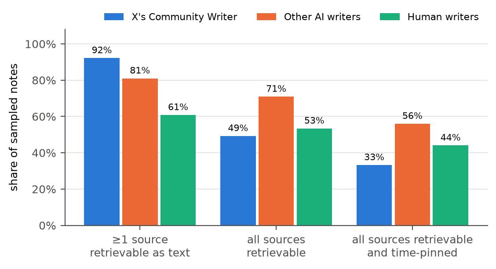
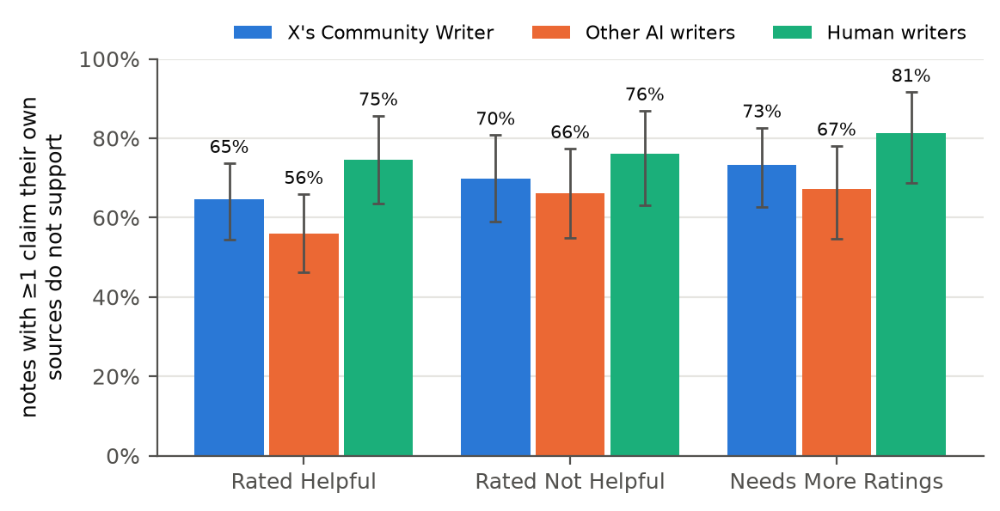
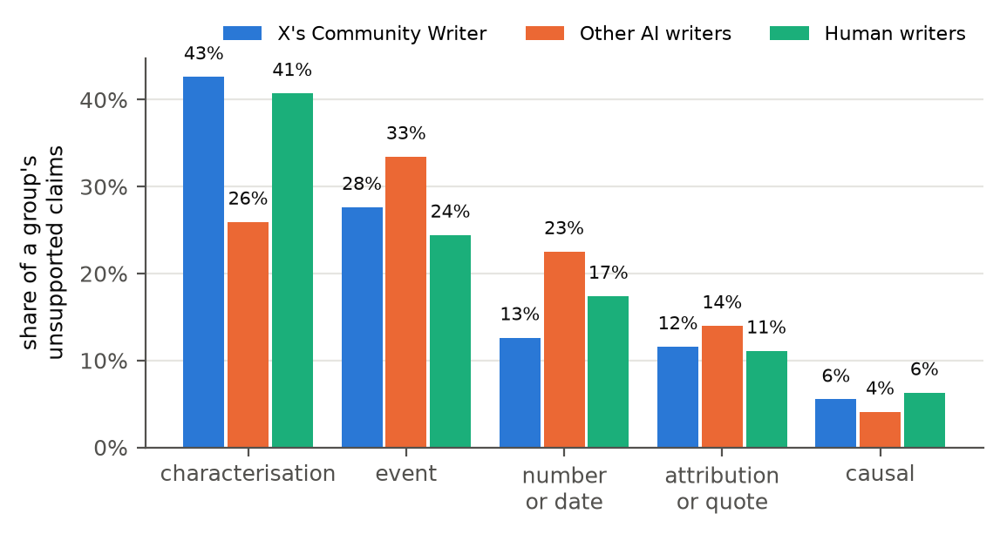

# Do AI Fact-Checks Say What Their Sources Say? An Independent Evidence Audit of AI-Written Community Notes

**Raj Gupta** · [affiliation] · AI x Epistemics Research Sprint (Apart Research), 13–16 Nov 2026
Code and data: https://github.com/rajkumar0932/Evidence-Audit-of-AI-Written-Community-Notes

## Abstract

AI accounts wrote 61% of the Community Notes on X that reached "Helpful" status in Aug–Oct 2026, mostly six X-run accounts. Published evaluations of these notes, X's own included, measure rater approval; none checks whether a note's cited sources support what it says.

We audit a pre-registered, stratified sample of 804 notes by X's Community Writer, other AI writers and humans, across all three rating statuses. We pin each source to its version at the time of writing and split notes into 3,545 claims. Every "supported" verdict must quote a passage that code verifies; 99% did. An independent judge from another model family agrees on 88% of claims (κ = 0.75), and a blind human spot-check confirms 91% of the judge's "unsupported" verdicts.

The platform's signals do not track evidence:

- Raters' "sources do not support note" tag detects unsupported notes no better than chance (AUROC 0.53, 95% CI 0.48–0.58).
- Helpful notes are unsupported about as often as Not Helpful ones (gap 3.8 points, CI −6 to +14).

AI notes are better grounded than human notes: on Helpful notes, 47% of claims by X's writer and 51% by other AI writers are supported by their own sources, against 26% for humans. Yet most notes from every writer contain at least one claim their sources do not establish.

Only 58% of notes could be fully bound to retrievable evidence. The audit costs about $4 of model usage and can be rerun on every public data release.

## 1. Introduction

Community Notes is the largest crowd fact-checking system in deployment. A note appears under a post only when raters who usually disagree both rate it helpful, and since September 2025 X also accepts notes written by AI. In our window (notes created 14 Aug–31 Oct 2026), AI accounts wrote **61%** of the notes that reached Helpful status (14,156 of 23,136). Six accounts with near-identical monthly quotas wrote 87.5% of all AI notes. They match the six accounts that X's open-source Community Writer lists as its own.

Three 2026 studies evaluate these AI notes, one of them by the X engineers who built the Community Writer [Gong & Wu 2026; De et al. 2026; Miller et al. 2026]. All three measure quality as a platform outcome: whether a note reached Helpful status, how fast, and with how many ratings. None checks whether a note's sources establish what it claims. Miller et al. name "whether helpfulness ratings track factual accuracy and source quality" as an open question.

The gap matters for three reasons:

- **The AI writers are optimised against the proxy.** The Community Writer's quality gates predict rater approval, and drafts predicted to fail are deleted.
- **It is a deployed instance of scalable oversight.** AI writes, humans rate, and an algorithm decides what millions see, so whether the human layer checks evidence is an empirical question with safety relevance.

**Contributions.**

1. The first claim-level, time-pinned audit of the evidence behind AI-written Community Notes, compared with human notes. It covers 804 notes and 3,545 claims and was pre-registered.
2. Tests of whether Helpful status and raters' own source tags track verified support. Neither does; the rater tag's AUROC is 0.53.
3. Evidence that AI notes are better grounded than human notes: 47–51% of claims supported on Helpful notes, against 26% for humans. Even so, most notes from every writer contain an unsupported claim.
4. A checkability measurement (only 58% of notes are fully checkable) and an open, re-runnable audit costing about $4 per run.

## 2. Related work

**AI note writers.**

- **Gong & Wu (2026)** characterise 20 AI writers up to May 2026. They are fast and prolific, with Helpful rates (12.1%) between those of experts and laypeople, but veracity is measured only as platform status.
- **De et al. (2026)** study human feedback on AI-drafted collaborative notes.
- **Miller et al. (2026)**, X engineers, describe the Community Writer: two Grok-based writers with web and X search, plus rejectors that predict helpfulness and check screenshots, context and revisions. Its writer is told to "confirm that the content of the URL supports" each note.
- **Indicator (2026)** reported that six X-run accounts wrote more than 90% of AI notes in September 2026.

**Sources in Community Notes.** Prior work rates the outlets notes cite, not whether a page supports the specific claim:

- Cited outlets skew towards high-factuality, left-leaning sources (Kangur et al. 2024).
- Linking external sources raises the odds of a helpful rating 2.7×, and high-bias sources lower them (Solovev & Pröllochs 2025).

**Checking claims against cited sources.**

- AIS (Rashkin et al. 2023) formalises "attributable to identified sources".
- ALCE (Gao et al. 2023) scores citation precision and recall.
- FActScore (Min et al. 2023) checks atomic facts.
- SourceCheckup (Wu et al. 2025) found 50–90% of LLM medical answers not fully supported by their own citations.

We bring these methods to a live, rater-governed deployment, and add sources pinned to the time of writing and mechanically verified quotes.

## 3. Data and methods

The study was pre-registered (`PREREGISTRATION.md`, committed 13 Nov 2026 at 23:57 IST) before any source was retrieved or note judged. Later changes are dated in Appendix C, and further method details are in Appendix F.

### 3.1 Data, groups and sample

We use X's public Community Notes data of 12 Nov 2026, covering notes created 14 Aug–31 Oct 2026 (286,940 notes).

- **AI writers** are accounts with `enrollmentState = apiEarnedIn`.
- **`cw`** (X's Community Writer) is the six highest-volume API accounts. Their near-identical monthly volumes match the six accounts in the Community Writer's `ACCOUNTS.md`.
- **`ai_other`** is the remaining API accounts, and **`human`** is everyone else.
- **Excluded:** collaborative notes, and notes with no status row (12.7%, consistent with deleted notes).

A seeded stratified sample takes 110 Currently-Rated-Helpful (CRH), 78 Not-Helpful (CRNH) and 80 Needs-More-Ratings (NMR) notes per group, **804 notes** in total. The `cw|CRNH` cell is a census.

### 3.2 Time-pinned sources, claims and quote-anchored verdicts

Each cited source is retrieved as it was when the note was written: the Wikipedia revision live at that time, otherwise the last Internet Archive snapshot before the note. Failing that, we use a snapshot from up to 7 days after, and failing that the live page, flagged as unpinned. X posts and video cannot be retrieved, so they count towards checkability only.

An LLM splits each note into standalone claims, keeping numbers, qualifiers and the note's language. Claims only about the post itself are out of scope.

A judge then sees only the claims and the retrieved source texts, never the author, group or status. It labels each claim `SUPPORTED`, `PARTIAL`, `NOT_IN_SOURCE` or `CONTRADICTED`. Every verdict except `NOT_IN_SOURCE` must quote the deciding passage verbatim. Code checks the quote against the source; a failed quote is re-asked once and otherwise coded `UNVERIFIED`.

We deliberately use a small, inexpensive model (`claude-haiku-5-5`, run through Claude Code's headless mode with tools disabled), so the audit costs about $4 per run and can be repeated monthly. Prompts were developed over three rounds on a disjoint 40-note pilot and frozen before the main run.

### 3.3 Validation and analysis

**Validation.** The judge is checked three ways:

- against a cross-family judge (`gemini-3.5-flash-lite`) on all Helpful notes;
- against a stronger reference judge (`claude-opus-5-5`) on the notes behind 90 stratified validation claims;
- by a blind, single-author human spot-check of 30 of those claims.

The pre-registered 90-claim human validation could not be completed (Appendix C). Rater-tag shares come from 12.5 M public ratings, with rater IDs discarded.

**Outcome.** A note is **UNSUPPORTED** if any of its checkable claims is `NOT_IN_SOURCE` or `CONTRADICTED`.

**Pre-registered tests.**

- **H1:** `cw` vs `human` among Helpful notes.
- **H2:** Not-Helpful vs Helpful within groups, and whether that gap differs by group.
- **H3:** the "sources do not support note" tag detects unsupported notes poorly (AUROC < 0.65).

We use 10,000-resample bootstrap CIs, permutation tests and Holm correction.

## 4. Results

The pipeline judged 621 of the 804 notes. Of the rest, 164 had no retrievable source and 19 no checkable claim. It produced 2,643 claim verdicts:

| Verdict | Claims |
|---|---|
| Supported | 1,122 |
| Partial | 561 |
| Not in source | 871 |
| Contradicted | 72 |
| Unverified | 17 |

99.0% of quotes were found verbatim in the source.

### 4.1 How much of the evidence can be checked

Of 1,548 cited URLs, 15% are X posts or pages and 5% are video or social media. At note level (Figure 1):

- **At least one retrievable source:** 92% of `cw` notes, but only 61% of human notes.
- **Every source retrievable:** only **58%** of all notes, and 49% for `cw`, which often pairs a web page with an X post.
- **Every source retrievable and pinned to the time of writing:** 44% of notes.

{width=64%}

*Figure 1. Share of sampled notes whose cited evidence can be retrieved as text (left), retrieved in full (middle), and retrieved in full and pinned to the time of writing (right).*

### 4.2 Are notes supported by their own sources? (H1)

Most notes in every group contain at least one claim their sources do not establish: 56–81% of checkable notes (Figure 2). Among Helpful notes:

| Group | Unsupported notes | 95% CI |
|---|---|---|
| `cw` | 64.6% | 54.5–73.7 |
| Other AI | 56.0% | 46.2–65.9 |
| Human | 74.6% | 63.5–85.7 |

- **Pre-registered H1:** the gap (`cw` − human) is −10.0 points (CI −24.1 to +4.3; p = .22, Holm p = .44).
- **Notes whose sources were all retrieved:** the gap widens to −19.2 points (CI −37.2 to −0.5; p = .06).
- **Robustness:** every sensitivity analysis points the same way (−3 to −13 points), and dropping any single `cw` account leaves its rate within 63–67%.

The difference is clearest at claim level. On Helpful notes, 47.1% of `cw` claims (CI 40.5–53.7) and 51.3% of other-AI claims are `SUPPORTED`, against **25.8%** (17.7–34.5) for human writers. Contradicted claims are rare: 5–10% of Helpful notes have one.

{width=64%}

*Figure 2. Share of checkable notes with at least one claim that the note's own sources do not support, by writer and rating status, with 95% bootstrap CIs.*

### 4.3 Does Helpful status track evidence? (H2)

Within groups, Not-Helpful notes are unsupported only 3.8 points more often than Helpful ones (CI −6.2 to +13.8; p = .23, Holm p = .44). The gap does not differ between `cw` and humans (interaction log-odds 0.12, CI −0.98 to +1.22). Helpful status, the measure every published evaluation of AI notes relies on, carries almost no evidence signal.

### 4.4 Do raters notice? (H3)

Among notes with at least 5 ratings (n = 567), the share of raters tagging "sources do not support note" separates unsupported from supported notes no better than chance. Its AUROC is **0.53** (CI 0.48–0.58), below 0.65 as pre-registered (Holm p = .0015).

- **Every other source tag is also at chance:** "cites high-quality sources" 0.48, "sources missing or unreliable" 0.52, "incorrect" 0.54.
- **So is each group** (Figure 3).
- **Across the whole window**, raters tick "cites high-quality sources" on 54% of ratings of Helpful notes, for all three groups alike.

{width=48%}

*Figure 3. ROC curves: share of raters tagging "sources do not support note" as a predictor of verified unsupported notes, by writer.*

### 4.5 Judge validation

| Check | Result |
|---|---|
| Cross-family judge (Gemini), 1,024 shared claims | 87.9% agreement on supported vs unsupported, κ 0.75 (AI-written 0.76, human-written 0.67) |
| Stronger reference (Claude Opus), 355 shared claims | 88.7% agreement, κ 0.74 |
| Same reference, 79 of the 90 validation claims | Weighted precision of "unsupported" 0.87, recall 0.88 |
| Blind human spot-check, one author, 29 decided claims | 69% agreement, κ 0.40. The author confirmed 12 of 13 of the judge's "unsupported" verdicts (weighted precision 0.91) |

**The comparisons hold under both judges that scored the full Helpful sample.** H1 is −8.8 points under Gemini against −10.0, and the H3 AUROC is 0.53 under both.

**The *level* of unsupported notes depends on the judge.** Opus is more lenient (58% against 70% on shared notes), Gemini stricter (76% against 64%), and the human author judged 69% of spot-checked claims unsupported where the primary judge said 45%. So the absolute rates in §4.2 are best read as a range, and if anything as conservative. Details are in Appendix D. The types of unsupported claims are in Appendix E; most are characterisations such as "the images are AI-generated".

## 5. Discussion and Limitations

**Helpful is not the same as supported.** The rating layer appears to evaluate whether a note *seems* helpful and well-sourced, not whether its sources establish its claims. AI writers are tuned to maximise rater approval, so nothing in the system pushes them towards better-grounded notes. That AI notes are nonetheless better grounded than human notes most likely reflects the Community Writer's explicit retrieve-and-confirm step: grounding is designed in, not selected for by the ratings.

**Recommendations.**

1. **Show raters the evidence.** Display the passage that supports each claim, so raters judge evidence rather than impressions.
2. **Bind claims to quotes.** Require AI writers to attach a verifiable quote to each claim; our pipeline verifies 99% of positive verdicts mechanically.
3. **Check independently.** Add an evidence check that does not share a model family with the writer.
4. **Archive what notes cite.** Link notes to archived copies made at writing time; 42% of notes cannot be fully checked today.

### Limitations

Limitations are detailed in Appendix A. The main ones are:

- **Judge error.** Two other judges agree substantially with the primary judge, and a 29-claim human spot-check confirms 91% of its "unsupported" verdicts. But human–judge agreement is only moderate (κ 0.40), and full human validation was not completed.
- **A strict note-level outcome.** One unsupported claim out of about 4.4 is enough; the claim-level rates are gentler.
- **Unretrievable sources.** X posts and video may support some claims we could not check.

### Future Work

Next steps are full human validation of the released 90-claim set by several labellers, and testing whether showing raters quoted evidence changes which notes become Helpful. The audit could also be extended to Meta's and TikTok's crowd-notes systems and run monthly as a standing monitor.

## 6. Conclusion

AI now writes most of the fact-checks X shows its users. Judged against their own cited sources, these notes are better grounded than human notes. But most notes from every writer contain a claim their sources do not establish, and the platform's human rating layer cannot tell supported notes from unsupported ones. Evaluations that stop at "rated helpful" miss the property that matters most for a fact-check. Evidence binding is cheap to measure and should be measured routinely.

## Code and Data

Code, verdicts, labels and all analysis outputs: https://github.com/rajkumar0932/Evidence-Audit-of-AI-Written-Community-Notes. Data: X's public Community Notes download of 12 Nov 2026. Every headline number is recomputed by `verify.py`.

## References

- De, S., Slaughter, I., Guo, J., Cheng, Q.-Y., Yan, J., Banerjee, S., Saveski, M. (2026). How Human Feedback Shapes AI-generated Community Notes. arXiv:2606.30905.
- Gao, T., Yen, H., Yu, J., Chen, D. (2023). Enabling Large Language Models to Generate Text with Citations. EMNLP 2023.
- Gong, Y., Wu, S. (2026). Characterizing AI Fact-Checkers and Their Contributions on Community Notes. arXiv:2605.16566.
- Indicator (2026, Oct 16). Briefing: X handed fact-checking to the crowd. Then it became the crowd. indicator.media.
- Kangur, U., Chakraborty, R., Sharma, R. (2024). Who Checks the Checkers? Exploring Source Credibility in Twitter's Community Notes. arXiv:2406.12444.
- Miller, B., Baxter, J., Chao, J., Coleman, K., Hilgard, S., Ortiz, D. (2026). Community-Driven API and AI Writer Design for Openly Scaling Community Notes. arXiv:2609.40067.
- Min, S., Krishna, K., Lyu, X., Lewis, M., Yih, W., Koh, P. W., Iyyer, M., Zettlemoyer, L., Hajishirzi, H. (2023). FActScore: Fine-grained Atomic Evaluation of Factual Precision in Long Form Text Generation. EMNLP 2023.
- Rashkin, H., et al. (2023). Measuring Attribution in Natural Language Generation Models. Computational Linguistics 49(4), 777–840. arXiv:2112.12870.
- Solovev, K., Pröllochs, N. (2025). References to unbiased sources increase the helpfulness of community fact-checks. arXiv:2503.10560.
- Wu, K., et al. (2025). An automated framework for assessing how well LLMs cite relevant medical references. Nature Communications 16, 3615. doi:10.1038/s41467-025-58551-6.
- xai-org/community-writer (2026). GitHub repository, Apache-2.0.

## Appendix A. Limitations and Dual-Use / Ethical Considerations

**Limitations.**

- **Observational design.** We measure association, not why notes are unsupported.
- **Limited human validation.** The pre-registered 90-claim blind human validation could not be completed. It was replaced by agreement with a cross-family judge and a stronger reference model, which cannot rule out errors that models share, and by a single-author spot-check of 30 claims (29 decided).
  - The spot-check shows moderate agreement (κ 0.40) and high precision of the judge's "unsupported" (0.91).
  - Its labels may be noisy: they were made quickly, by one person, from a key-word view. Quote verification removes hallucinated support but not mistaken "not in source" verdicts. Human labelling of the released 90-claim validation set is the most important next step.
- **Missing sources.** A claim may be supported by a source we could not retrieve (an X post, a video). Hence the all-sources-retrieved analysis, in which the AI–human gap widens.
- **Time pinning.** 59 sources come from snapshots after the note was written and 279 are live copies; these may differ from what the writer saw.
- **Deleted notes** are invisible in the public data, and X's writer deletes drafts predicted to fail.
- **Account mapping.** The `cw` label rests on volume patterns that match X's published account list.
- **Strict outcome.** The note-level outcome counts a single unsupported claim; claim-level rates are reported alongside.
- **Scope.** Statuses change over time, and the study covers one platform in one 11-week window.
- **Model families.** The judges come from model families other than the writer's (Claude and Gemini judging Grok-written notes). That is deliberate, since it avoids a model checking its own work. Authorship-specific bias is tested by κ split by authorship.

**Dual use and ethics.**

- **Data.** All data is public. Participant IDs are pseudonymous. We report no statistics for individual human writers and do not re-host note text; we release IDs, verdicts, labels and code. The AI accounts belong to an organisation and are publicly documented.
- **Gaming.** A catalogue of "unsupported but rated Helpful" notes could help someone write notes that pass raters without support. We report categories, not templates.
- **Misuse of the findings.** Results could be used to discredit crowd fact-checking as a whole. We report the human baseline alongside the AI groups, and the main recommendations strengthen the system rather than replace it. We will share the findings with the Community Notes team.

## Appendix B. Prompts

The frozen prompts are `prompts/decompose.md` (SHA-256 `24c9df9a…`) and `prompts/judge.md` (SHA-256 `08d3b5a2…`) in the repository.

## Appendix C. Pre-registration timeline and deviations

| When (IST) | Event |
|---|---|
| 13 Nov, 23:57 | Stage 1 committed: question, data, sample, outcomes, hypotheses, analysis plan |
| 14 Nov, before any judging | Added the all-sources-retrieved sensitivity analysis; specified how `UNVERIFIED` verdicts count; defined H2a as a within-group gap (a synthetic dry run showed the pooled version confounded) |
| 15 Nov, 21:48 | Stage 2 committed before the main run: prompts frozen after three pilot rounds; switch from `claude-opus-5-5` to `claude-haiku-5-5` via Claude Code headless mode, for cost reasons |
| 15 Nov, 22:35 | Human validation reduced from 150 to 90 claims (time), before any label was collected |
| 15 Nov, ~22:55 | Human validation not completed; replaced by a cross-family judge (Gemini) and a stronger reference judge (Claude Opus 5.5), after the primary run (§3.5) |
| 16 Nov, ~09:00 | Quick blind human spot-check of 30 claims (binary question) registered before any label; two labelling passes, 29 decided labels in the second (§4.5) |

All entries are in the repository's git history.

## Appendix D. Judge validation details

**Cross-family agreement.** On 1,024 claims scored by both the primary judge (Claude Haiku 5.5) and Gemini 3.5 Flash-Lite:

| Comparison | Agreement | Cohen's κ |
|---|---|---|
| Supported vs unsupported | 87.9% | 0.75 |
| All four labels | 75.6% | 0.61 |
| Note-level UNSUPPORTED (251 notes) | 86.9% | 0.69 |

- **No authorship bias:** agreement is similar for AI-written notes (κ 0.76, supported vs unsupported) and human-written notes (κ 0.67).
- **Where they disagree:** mostly the `PARTIAL`/`SUPPORTED` boundary (112 claims the primary judge called `PARTIAL` were `SUPPORTED` for Gemini) and `PARTIAL`/`NOT_IN_SOURCE` (79).
- **Gemini is stricter, not more lenient.** It marks 76% of notes unsupported, against the primary judge's 64%. The high unsupported rates are not an artefact of the primary judge.

**Findings under each judge.** Recomputed with Gemini's verdicts, the conclusions are unchanged:

- **H1:** X's writer is 8.8 points below humans among Helpful notes (CI −21.4 to +4.0), against 10.0 points with the primary judge.
- **H3:** the rater-tag AUROC is 0.53 under both judges.

**Stronger reference.** Claude Opus 5.5 re-judged 60 of the 86 validation notes before a usage limit stopped it, covering 79 of the 90 stratified validation claims and 355 claims in all.

| Comparison with Opus | Result |
|---|---|
| Supported vs unsupported, all 355 shared claims | 88.7% agreement, κ = 0.74 |
| Same, AI-written notes | κ = 0.77 |
| Same, human-written notes | κ = 0.63 |
| Primary judge's "unsupported" on the 79 validation claims (weighted) | precision 0.87, recall 0.88 |

By label, the reference confirms:

- **almost every `SUPPORTED`** (100% of validation claims) **and `NOT_IN_SOURCE`** (89%);
- **few `CONTRADICTED` verdicts.** It mostly downgrades them to `PARTIAL` or `NOT_IN_SOURCE`. The rare contradicted label should be read as "not supported", not as a confirmed contradiction.

**The *level* of unsupported notes depends on the judge; the comparisons do not.**

- On the 76 notes it shares with the primary judge, Opus marks 58% unsupported, against the primary judge's 70%.
- On its 251 notes, Gemini marks 76%, against the primary judge's 64%.

The absolute rates in §4.2 should therefore be read as a range across judges. The AI–human gap (§4.2) and the null rater signal (§4.4) hold under both judges that scored the full Helpful sample (Claude Haiku and Gemini).

**Human spot-check.** One author blindly labelled 30 of the validation claims (10 per group) with a single question: does the source support at least the main point? To save time, the labelling view showed the passages around the claim's key words by default, with the full text one click away.

- **Two passes.** A first pass decided 7 claims. A second pass, using the full text, decided 29 (9 supported, 20 not supported, 1 can't tell). The 7 first-pass labels were unchanged.
- **Agreement on the 29 decided claims:**

| Judge | Agreement with the author | κ | Weighted precision of "unsupported" | Weighted recall |
|---|---|---|---|---|
| Primary (Claude Haiku) | 69% | 0.40 | **0.91** | 0.63 |
| Claude Opus | 63% | 0.32 | 0.90 | 0.59 |
| Gemini (14 claims) | 64% | 0.31 | 0.81 | 0.74 |

- **Where they disagree.** The author was stricter than every judge: 69% of claims not supported. When the primary judge said "unsupported", the author agreed in 12 of 13 cases. 8 of the 9 disagreements are claims the judge called `SUPPORTED` or `PARTIAL` and the author did not.
- **All 8 of those judge quotes are verified verbatim in the source, and 7 of the 8 were visible in the default labelling view.** These disagreements therefore reflect a stricter standard on the author's part, labelling error, or judge leniency. A check this small cannot separate those explanations.

The spot-check gives no sign that the judge over-flags unsupported claims. Relative to this labeller, judge-based unsupported rates are conservative. With 29 claims and one labeller, it is not a substitute for full validation.

## Appendix E. What unsupported claims look like

Characterisations are the largest share of unsupported claims for X's writer (43%) and humans (41%), followed by event claims (Figure 4). Typical characterisations are "the images are AI-generated" or "the account is a parody". Other AI writers' unsupported claims are more often specific numbers and dates (23%).

The pilot showed two recurring patterns:

- **Unsourced labels.** A note asserts a label (fabricated, AI-generated) and cites a page that only shows where the content came from.
- **Over-specified details.** A note states a precise figure, date or causal detail (for example an "uncontrolled" dive) that its source gives only partly.

*Figure 4. Claim types among each group's unsupported claims.*

## Appendix F. Method details

**Sample.** 110 notes per Helpful cell gives about 80% power to detect a 25% vs 10% difference at α = .05. In the window, 41 accounts were enrolled as AI writers, 28 of them active. Notes with no status row are 12.7% of every creation week, consistent with deleted notes rather than publication lag.

**Retrieval.** Wikipedia revisions come from the MediaWiki API. Web pages come from Internet Archive snapshots found through the availability API and time-bounded CDX queries. Main text is extracted with trafilatura, keeping the full visible text as a fallback; PDF text uses pypdf. Archived payloads still compressed with zstd, gzip or brotli are decompressed first.

Of 1,240 fetchable URLs, we retrieved text for 91% and time-pinned text for 77%:

| Retrieval route | URLs |
|---|---|
| Archive snapshot before the note | 790 |
| Wikipedia revision at writing time | 109 |
| Archive snapshot after the note | 59 |
| Archived copy cited by the note itself | 3 |
| Live page, not time-pinned | 279 |

**Claims.** Claims are typed as number/date, attribution/quote, causal, characterisation, event, or about-the-post (out of scope; 9.9% of the 3,545 claims).

**Quote verification.** Quotes are matched after normalising Unicode, quote marks, dashes and whitespace. A quote of 8 or more words may differ in at most 10% of its six-word shingles.

**Models and cost.**

- **Primary model:** `claude-haiku-5-5`, run through Claude Code's headless mode (`claude -p`) with tools, MCP servers, skills and settings disabled, from an empty working directory.
- **Effort:** medium for claim splitting, high for verdicts.
- **Cost:** about $4.20 at API prices (claims $0.73, verdicts $3.50).
- **Other judges:** the second judge is `gemini-3.5-flash-lite` on the free tier; the reference judge is `claude-opus-5-5`.

**Pilot.** Three prompt rounds on 40 disjoint notes fixed two failure modes:

1. A source that merely repeats the claim being corrected (for example, a parody post) was counted as contradicting the note.
2. Qualifiers such as "not officially announced" were dropped, and one claim was mistranslated.

The `CONTRADICTED` label fell from 6 to 2 of the pilot's verdicts, and every pilot quote was verified.

**Statistics.**

- **H2a** is the weighted average of within-group gaps (weights: each group's CRH + CRNH population), tested by permuting status within groups.
- **H2b** is the status × group interaction in a logistic regression that controls for the number of URLs and the log of note length.
- **Sensitivity analyses:**
  - `PARTIAL` counted as unsupported;
  - `UNVERIFIED` counted as unsupported;
  - notes with all sources retrieved;
  - time-pinned sources only;
  - excluding notes that cite Wikipedia;
  - leaving out each `cw` account in turn.

## LLM Usage Statement

This project was carried out with extensive assistance from Claude (Anthropic), used through Claude Code. Claude:

- helped choose and scope the research question;
- wrote the data-processing, retrieval, judging and analysis code, and ran the pipeline;
- drafted this report.

The author directed the work, chose among the options proposed, carried out the human spot-check, and reviewed the report.

Language models are also part of the method itself (§3): Claude Haiku 5.5 is the primary judge, Claude Opus 5.5 the reference judge, and Gemini 3.5 Flash-Lite the second judge.

All numbers in the report are produced by the released code from public data and can be recomputed with `verify.py`. References were checked against their sources.
