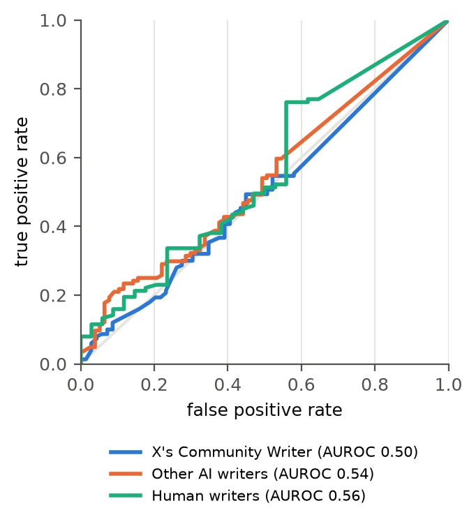

# Do AI Fact-Checks Say What Their Sources Say? An Independent Evidence Audit of AI-Written Community Notes

**Raj Gupta** · [affiliation] · AI x Epistemics Research Sprint (Apart Research), 13–16 Nov 2026
Code and data: https://github.com/rajkumar0932/Evidence-Audit-of-AI-Written-Community-Notes

## Abstract

AI accounts wrote 61% of the Community Notes on X that reached "Helpful" status in Aug–Oct 2026, mostly six X-run accounts. Published evaluations of these notes, X's own included, measure rater approval; none checks whether a note's cited sources support what it says.

We audit a pre-registered, stratified sample of 804 notes by X's Community Writer, other AI writers and humans, across all three rating statuses. We pin each source to its version at the time of writing and split notes into 3,545 claims. Every "supported" verdict must quote a passage that code verifies; 99% did. An independent judge from another model family agrees on 88% of claims (κ = 0.75), and a blind human spot-check confirms 91% of the judge's "unsupported" verdicts.

The platform's signals do not track evidence:

- Raters' "sources do not support note" tag detects unsupported notes no better than chance (AUROC 0.53, 95% CI 0.48–0.58).
- Helpful notes are unsupported about as often as Not Helpful ones (gap 3.8 points, CI −6 to +14).

AI notes are better grounded than human notes: on Helpful notes, 47% of claims by X's writer and 51% by other AI writers are supported by their own sources, against 26% for humans. Yet most notes from every writer contain at least one claim their sources do not establish.

Only 58% of notes could be fully bound to retrievable evidence. The audit costs about $4 of model usage and can be rerun on every public data release.

## 1. Introduction

Community Notes is the largest crowd fact-checking system in deployment. A note is shown under a post only when raters who usually disagree with each other both rate it helpful. Since September 2025, X has also accepted notes written by AI.

In our window (notes created 14 Aug–31 Oct 2026), AI accounts wrote **61%** of the notes that reached Helpful status: 14,156 of 23,136. Six accounts with near-identical monthly quotas wrote 87.5% of all AI notes. Their volumes match the six accounts that X's open-source Community Writer lists as its own (§3.1).

Three 2026 studies evaluate these AI notes, one by the X engineers who built the Community Writer. All three measure quality as a platform outcome: whether a note reached Helpful status, how quickly, and with how many ratings [Gong & Wu 2026; De et al. 2026; Miller et al. 2026]. None checks whether the sources a note cites establish what it claims. Miller et al. name "whether helpfulness ratings track factual accuracy and source quality" as an open question, and Gong & Wu list evidence-grounding assessment as future work.

The gap matters for three reasons:

- **The AI writers are optimised against the proxy.** The Community Writer's quality gates are LLM predictions of what raters will find helpful, and a model deletes drafts predicted to fail. Its writer is told to "confirm that the content of the URL supports" each note, so the same model family drafts the note and checks its sources.
- **It is a deployed instance of scalable oversight.** AI writes, humans rate, and an algorithm decides what millions of users see. Whether the human layer checks evidence is an empirical question.
- **Checkability decides what can be audited.** It matters what share of a live fact-checking system's evidence an outsider can bind to retrievable text.

**Findings.**

1. **The platform's signals are blind to evidence support.** Raters' source tags detect unsupported notes at chance level (AUROC 0.48–0.54 for every source-related tag). Helpful and Not Helpful notes are unsupported at similar rates.
2. **AI notes are better grounded than human notes, not worse.** The claim-level support rate on Helpful notes is 47% for X's writer and 51% for other AI writers, against 26% for humans. At note level, X's Helpful notes are 10 points less likely than human ones to contain an unsupported claim (not significant). The gap is 19 points among notes whose sources were all retrieved (95% CI −37 to −0.5).
3. **Unsupported claims are nevertheless the norm.** 56–81% of checkable notes in every group contain at least one claim their own sources do not establish. Most such claims are characterisations ("the image is AI-generated") and event claims.
4. **A large share of the evidence cannot be checked at all.** 42% of notes cite at least one source that cannot be retrieved as text (X posts, video, dead or paywalled pages).

**Contributions.**

- The first claim-level, time-pinned audit of the evidence behind AI-written Community Notes, compared with human notes.
- Pre-registered tests of whether Helpful status and raters' own source tags track verified support.
- A checkability measurement for a live fact-checking system.
- An open audit that anyone can rerun: verdicts are anchored to quotes that can be checked by string match, and a run costs about $4.

## 2. Background and related work

**Community Notes and AI writers.** Notes reach "Currently Rated Helpful" (CRH) through a matrix-factorisation model that requires agreement across raters who usually disagree. Notes that fail reach "Currently Rated Not Helpful" (CRNH), and most notes stay at "Needs More Ratings" (NMR).

- **Gong & Wu (2026)** characterise 20 AI writers up to May 2026. They find AI writers fast and prolific, with CRH rates (12.1%) between those of experts and laypeople. Their measure of veracity is platform status.
- **De et al. (2026)** study how human feedback shapes AI-drafted collaborative notes.
- **Miller et al. (2026)**, X engineers, describe the Community Writer. It runs two Grok-based writers with web, URL and X search tools, plus rejectors that predict helpfulness and check screenshots, recent context and revisions.
- **Indicator (2026)** reported that six X-run accounts wrote more than 90% of AI notes in September 2026.

**Sources in Community Notes.** Earlier work rates the *outlets* that notes cite, not whether a cited page supports the specific claim:

- Kangur et al. (2024) find that cited outlets skew towards high-factuality, left-leaning sources.
- Solovev & Pröllochs (2025) find that linking external sources raises the odds of a note being rated helpful (2.7×), and that high-bias sources lower them.

**Checking claims against cited sources.** Several methods test whether generated text is supported by its sources:

- AIS (Rashkin et al. 2023) formalises "attributable to identified sources".
- ALCE (Gao et al. 2023) scores citation precision and recall.
- FActScore (Min et al. 2023) splits text into atomic facts and checks each one.
- SourceCheckup (Wu et al. 2025) found that 50–90% of LLM medical answers were not fully supported by their own citations.

We bring this family of methods to a live, rater-governed deployment, and add sources pinned to the time of writing and quotes verified mechanically.

## 3. Data and methods

The study was **pre-registered** in the repository's `PREREGISTRATION.md`, committed on 13 Nov 2026 at 23:57 IST, before any source was retrieved or any note judged. Later changes, all made before judging, are dated in Appendix C.

### 3.1 Data and groups

We use X's public Community Notes data of 12 Nov 2026 (notes, status history, user enrollment and ratings; checksums are in the repository).

- **Window:** notes created 14 Aug–31 Oct 2026, which leaves at least 12 days for statuses to settle. That is 286,940 notes.
- **AI writers:** accounts with `enrollmentState = apiEarnedIn` (41 accounts; 28 active in the window).
- **X's writer (`cw`):** the six highest-volume API accounts. Their monthly volumes are near-identical (Aug 3,779–3,857; Sep 7,374–7,510; Oct 8,688–8,825), consistent with fixed quotas and with the six accounts listed in the Community Writer's `ACCOUNTS.md`.
- **Other groups:** `ai_other` is the remaining API accounts; `human` is everyone else.
- **Exclusions:**
  - collaborative notes;
  - notes with no status row (12.7%). That share is stable across creation weeks, consistent with deleted notes.

### 3.2 Sample

We drew a seeded stratified sample of notes that contain a URL:

- **Strata:** 3 groups × 3 statuses (CRH 110, CRNH 78, NMR 80 per group), **804 notes** in total. `cw` has exactly 78 CRNH notes, so that cell is a census.
- **Pilot:** a disjoint set of 40 notes from 1–9 Nov, used only to develop prompts.
- **Weights:** population sizes for each cell are released for weighting.

### 3.3 Time-pinned source retrieval

Each cited URL is classified as an X post, other X page, video or social media, Wikipedia, or web page.

- **Wikipedia:** we retrieve the revision that was live when the note was written, via the MediaWiki API.
- **Web pages:** we use the last Internet Archive snapshot *before* the note's creation time; else the first snapshot within 7 days after; else the live page, flagged as unpinned.
- **Text extraction:** main text with trafilatura, keeping the full visible text as a fallback; PDF text via pypdf; still-compressed archive payloads are decompressed first.
- **Not retrieved:** X posts and video count towards checkability, not towards support.

### 3.4 Claims and quote-anchored verdicts

An LLM splits each note into standalone claims, keeping numbers, names, quotes, qualifiers and the note's language. Each claim is typed as number/date, attribution/quote, causal, characterisation, event or about-the-post. Claims about the post itself are out of scope.

A judge then receives only the in-scope claims and the retrieved source texts. It never sees the author, group or status. For each claim it returns one of:

- `SUPPORTED`: a source states or entails it, including every specific detail;
- `PARTIAL`: the core is supported but a detail is missing or differs;
- `NOT_IN_SOURCE`: no source establishes it, even if it is true;
- `CONTRADICTED`: a source says something incompatible with the claim as qualified.

Every verdict except `NOT_IN_SOURCE` must quote the deciding passage verbatim. Code checks the quote against the retrieved text, after normalising Unicode, quote marks, dashes and whitespace. A failed quote is re-asked once, and otherwise coded `UNVERIFIED`.

**Model choice.** We deliberately use a small, inexpensive model, `claude-haiku-5-5`, for both claim splitting and verdicts. It runs through Claude Code's headless mode with tools, plugins and settings disabled, from an empty working directory. The whole audit costs about $4 at API prices, so a platform or researcher could repeat it monthly. Its reliability is tested against two other judges (§3.5), not assumed.

**Prompt development.** Prompts went through three rounds on the pilot and were frozen before the main run (Appendix C). The pilot fixed two failure modes:

- treating a quoted rumour as evidence against the note that debunks it;
- dropping qualifiers such as "not officially announced".

### 3.5 Judge validation

We pre-registered a blind human validation of 90 claims, stratified by group and by the judge's label. It could not be completed in the time available (Appendix C). We instead test the judge against two other judges, scoring the same claims with the same frozen prompt and quote verification:

1. **Cross-family judge.** `gemini-3.5-flash-lite` (Google, free tier) scored every Helpful note plus the validation notes: 251 judged notes, 1,024 shared claims.
2. **Stronger same-family reference.** `claude-opus-5-5` scored the notes behind the 90 stratified validation claims. On those 90 claims we report weighted precision and recall of the primary judge's "unsupported".

We report Cohen's κ overall and split by AI vs human authorship, which tests for authorship-dependent bias. We also recompute H1 and H3 under each judge. A small blind human spot-check (30 claims, one author, binary question) was added before any label was collected. Model agreement cannot rule out errors that models share, so full human validation remains future work.

### 3.6 Ratings and analysis

From the ratings data (12.5 M ratings on notes in the window) we compute, for each note, the share of ratings that use each source-related tag. Rater IDs are discarded.

- **Primary outcome:** a note is **UNSUPPORTED** if at least one of its checkable claims is `NOT_IN_SOURCE` or `CONTRADICTED`.
- **Pre-registered hypotheses:**
  - **H1:** `cw` and `human` differ among Helpful notes.
  - **H2a:** CRNH notes are more often unsupported than CRH notes, measured as a weighted within-group gap.
  - **H2b:** that gap differs between `cw` and `human` (interaction).
  - **H3:** the "sources do not support note" tag detects unsupported notes poorly (AUROC < 0.65).
- **Statistics:** 10,000-resample bootstrap CIs, permutation tests, and Holm correction across H1, H2a and H3.

## 4. Results

The pipeline judged 621 of the 804 notes. The other 183 had no retrievable source (164) or no checkable claim (19). In all it produced 2,643 claim verdicts:

| Verdict | Claims |
|---|---|
| `SUPPORTED` | 1,122 |
| `PARTIAL` | 561 |
| `NOT_IN_SOURCE` | 871 |
| `CONTRADICTED` | 72 |
| `UNVERIFIED` | 17 |

1,755 of 1,772 quotes (99.0%) were found verbatim in the cited source.

### 4.1 How much of the evidence can be checked

Of the 1,548 URLs cited by sampled notes, 15% are X posts or pages and 5% are video or social media. Of the 1,240 fetchable URLs we retrieved text for 91%, and time-pinned text for 77%. At note level (Figure 1):

- **At least one retrievable source:** 92% of `cw` notes, against 61% of human notes.
- **Every cited source retrievable:** only **58%** of notes overall, and 49% for `cw`, whose notes often pair a web page with an X post or video.
- **Every source retrievable and pinned:** 44% of notes.

Evidence hosted on X is the least auditable from outside the platform.

*Figure 1. Share of sampled notes whose cited evidence can be retrieved as text (left), retrieved in full (middle), and retrieved in full and pinned to the time of writing (right).*

### 4.2 Are notes supported by their own sources? (H1)

Most notes in every group contain at least one claim their cited sources do not establish (Figure 2): 56–81% of checkable notes. Among Helpful notes:

| Group | Unsupported notes | 95% CI |
|---|---|---|
| X's writer (`cw`) | 64.6% | 54.5–73.7 |
| Other AI writers | 56.0% | 46.2–65.9 |
| Human writers | 74.6% | 63.5–85.7 |

- **H1 (pre-registered):** X's writer is 10.0 points *below* humans (CI −24.1 to +4.3; p = .22; Holm p = .44). It is not significant.
- **Fairest comparison:** restricted to notes whose sources were all retrieved, the gap widens to 19.2 points (CI −37.2 to −0.5; permutation p = .06). That restriction removes notes whose claims may rest on an unretrievable X post.
- **Robustness:** every other sensitivity analysis points the same way, with gaps of −3 to −13 points. Leaving out any one of X's six accounts keeps its rate between 63% and 67%.

The clearest difference is at the claim level. On Helpful notes, 47.1% of claims by X's writer (CI 40.5–53.7) and 51.3% by other AI writers are `SUPPORTED`, against **25.8%** (17.7–34.5) for human writers. AI writers, which are instructed to retrieve and confirm each URL, cite sources that more often say what the note says.

Notes with a contradicted claim are rare for every group: 5–10% of Helpful notes.

*Figure 2. Share of checkable notes with at least one claim that the note's own sources do not support, by writer and rating status, with 95% bootstrap CIs.*

### 4.3 Does Helpful status track evidence? (H2)

Within each group, notes rated Not Helpful are unsupported only 3.8 points more often than notes rated Helpful (weighted within-group gap; CI −6.2 to +13.8; one-sided p = .23; Holm p = .44). The gap does not differ between X's writer and humans (interaction log-odds 0.12, CI −0.98 to +1.22).

So Helpful status, the measure every published evaluation of AI notes relies on, carries almost no information about whether a note's evidence supports it.

### 4.4 Do raters notice? (H3)

Among notes with at least 5 ratings (n = 567), the share of raters tagging "sources do not support note" separates unsupported from supported notes no better than chance:

- **Primary tag:** AUROC **0.53** (CI 0.48–0.58). It is below 0.65 as pre-registered (Holm p = .0015).
- **Every other source-related tag is also at chance:** "cites high-quality sources" 0.48, "sources missing or unreliable" 0.52, "incorrect" 0.54.
- **Within groups** (Figure 3): 0.50 for X's writer, 0.54 for other AI writers, 0.56 for human writers.
- **Across the whole window**, raters tick "cites high-quality sources" on 54% of ratings of Helpful notes for all three groups alike (53.7–54.1%).

Raters' judgements about sources do not reflect what the sources say.

*Figure 3. ROC curves: share of raters tagging "sources do not support note" as a predictor of verified unsupported notes, by writer.*

### 4.5 Judge validation

The primary judge was checked three ways (full details in Appendix D):

| Check | Result |
|---|---|
| Cross-family judge (Gemini), 1,024 shared claims | 87.9% agreement on supported vs unsupported, κ 0.75 |
| Same, by authorship | κ 0.76 on AI-written notes, 0.67 on human-written notes |
| Stronger reference (Claude Opus), 355 shared claims | 88.7% agreement, κ 0.74 |
| Same, on 79 of the 90 stratified validation claims | weighted precision of "unsupported" 0.87, recall 0.88 |
| Blind human spot-check by one author, 29 decided claims | 69% agreement, κ 0.40; the author confirmed 12 of 13 of the judge's "unsupported" verdicts (weighted precision 0.91) |

**Headline findings.** The findings hold under both judges that scored the full Helpful sample:

- **H1:** X's writer is 8.8 points below humans under Gemini, against 10.0 points under the primary judge.
- **H3:** the rater-tag AUROC is 0.53 under both.

**What depends on the judge.** The *level* of unsupported notes does:

- Opus marks fewer notes unsupported than the primary judge (58% vs 70% on shared notes).
- Gemini marks more (76% vs 64% of notes).
- On the 29 spot-checked claims, the human author judged 69% unsupported, where the primary judge said 45%.

The absolute rates in §4.2 should therefore be read as a range. Both the cross-family judge and the human spot-check suggest the primary judge's unsupported rates are, if anything, conservative.

### 4.6 What unsupported claims look like

Characterisations ("the images are AI-generated", "the account is a parody") are the largest share of unsupported claims for X's writer (43%) and human writers (41%), followed by event claims. Other AI writers' unsupported claims are more often specific numbers and dates (23%). Details are in Appendix E.

## 5. Discussion

**Helpful is not the same as supported.** The rating layer of the largest deployed fact-checking system appears to evaluate whether a note *seems* helpful and well-sourced, not whether its sources establish its claims. Raters' source tags are at chance, and the status they produce carries almost no evidence signal.

This matters most because the AI writers are tuned to predict and maximise rater approval. A system that optimises against a signal blind to evidence has no pressure towards better-grounded notes. Our finding that AI notes are *nonetheless* better grounded than human notes most likely reflects the Community Writer's explicit retrieve-and-confirm step. Grounding is designed in; it is not selected by the ratings.

**Recommendations.**

1. **Make checking cheap for raters.** Show the passage that supports each claim next to the note, so raters judge evidence rather than impressions.
2. **Bind claims to quotes at writing time.** Require AI writers to attach a verifiable quote to each claim. Our pipeline shows this is mechanically checkable for 99% of positive verdicts.
3. **Check evidence independently.** Add an evidence check that does not share a model family with the writer.
4. **Archive what notes cite.** Notes should link to archived copies made at writing time. 42% of notes cannot be fully checked today, and evidence hosted on X cannot be checked from outside at all.

**An audit that cannot go stale.** The public data refreshes daily and a full run costs a few dollars, so this audit can be repeated every month. A benchmark built on a live deployment, with fresh data each run, avoids the contamination and saturation problems of static evaluations.

**Limitations** are detailed in Appendix A. The most important are:

- **Judge error.** Two other judges agree substantially with the primary judge, and a 29-claim human spot-check confirms 91% of its "unsupported" verdicts (§4.5). Human–judge agreement overall is only moderate (κ 0.40).
- **A strict note-level outcome.** One unsupported claim out of about 4.4 makes a note unsupported; the claim-level rates are the gentler measure.
- **Characterisations a source cannot establish.** Some characterisations ("this account is a parody") may be supported by the account itself rather than by any page we could retrieve.

## 6. Conclusion

AI now writes most of the fact-checks that X shows its users. Judged against their own cited sources, these AI notes are better grounded than the human notes they sit alongside. But most notes from every writer contain at least one claim their sources do not establish, and the platform's human rating layer cannot tell supported notes from unsupported ones.

Evaluations that stop at "rated helpful" therefore miss the property that matters most for a fact-check. Evidence binding is cheap to measure, and should be measured routinely.

## References

- De, S., Slaughter, I., Guo, J., Cheng, Q.-Y., Yan, J., Banerjee, S., Saveski, M. (2026). How Human Feedback Shapes AI-generated Community Notes. arXiv:2606.30905.
- Gao, T., Yen, H., Yu, J., Chen, D. (2023). Enabling Large Language Models to Generate Text with Citations. EMNLP 2023.
- Gong, Y., Wu, S. (2026). Characterizing AI Fact-Checkers and Their Contributions on Community Notes. arXiv:2605.16566.
- Indicator (2026, Oct 16). Briefing: X handed fact-checking to the crowd. Then it became the crowd. indicator.media.
- Kangur, U., Chakraborty, R., Sharma, R. (2024). Who Checks the Checkers? Exploring Source Credibility in Twitter's Community Notes. arXiv:2406.12444.
- Miller, B., Baxter, J., Chao, J., Coleman, K., Hilgard, S., Ortiz, D. (2026). Community-Driven API and AI Writer Design for Openly Scaling Community Notes. arXiv:2609.40067.
- Min, S., Krishna, K., Lyu, X., Lewis, M., Yih, W., Koh, P. W., Iyyer, M., Zettlemoyer, L., Hajishirzi, H. (2023). FActScore: Fine-grained Atomic Evaluation of Factual Precision in Long Form Text Generation. EMNLP 2023.
- Rashkin, H., et al. (2023). Measuring Attribution in Natural Language Generation Models. Computational Linguistics 49(4), 777–840.
- Solovev, K., Pröllochs, N. (2025). References to unbiased sources increase the helpfulness of community fact-checks. arXiv:2503.10560.
- Wu, K., et al. (2025). An automated framework for assessing how well LLMs cite relevant medical references. Nature Communications 16, 3615.
- xai-org/community-writer (2026). GitHub repository, Apache-2.0.

## Appendix A. Limitations and Dual-Use / Ethical Considerations

**Limitations.**

- **Observational design.** We measure association, not why notes are unsupported.
- **Limited human validation.** The pre-registered 90-claim blind human validation could not be completed. It was replaced by agreement with a cross-family judge and a stronger reference model, which cannot rule out errors that models share, and by a single-author spot-check of 30 claims (29 decided).
  - The spot-check shows moderate agreement (κ 0.40) and high precision of the judge's "unsupported" (0.91).
  - Its labels may be noisy: they were made quickly, by one person, from a key-word view. Quote verification removes hallucinated support but not mistaken "not in source" verdicts. Human labelling of the released 90-claim validation set is the most important next step.
- **Missing sources.** A claim may be supported by a source we could not retrieve (an X post, a video). Hence the all-sources-retrieved analysis, in which the AI–human gap widens.
- **Time pinning.** 59 sources come from snapshots after the note was written and 279 are live copies; these may differ from what the writer saw.
- **Deleted notes** are invisible in the public data, and X's writer deletes drafts predicted to fail.
- **Account mapping.** The `cw` label rests on volume patterns that match X's published account list.
- **Strict outcome.** The note-level outcome counts a single unsupported claim; claim-level rates are reported alongside.
- **Scope.** Statuses change over time, and the study covers one platform in one 11-week window.
- **Model families.** The judges come from model families other than the writer's (Claude and Gemini judging Grok-written notes). That is deliberate, since it avoids a model checking its own work. Authorship-specific bias is tested by κ split by authorship.

**Dual use and ethics.**

- **Data.** All data is public. Participant IDs are pseudonymous. We report no statistics for individual human writers and do not re-host note text; we release IDs, verdicts, labels and code. The AI accounts belong to an organisation and are publicly documented.
- **Gaming.** A catalogue of "unsupported but rated Helpful" notes could help someone write notes that pass raters without support. We report categories, not templates.
- **Misuse of the findings.** Results could be used to discredit crowd fact-checking as a whole. We report the human baseline alongside the AI groups, and the main recommendations strengthen the system rather than replace it. We will share the findings with the Community Notes team.

## Appendix B. Prompts

The frozen prompts are `prompts/decompose.md` (SHA-256 `24c9df9a…`) and `prompts/judge.md` (SHA-256 `08d3b5a2…`) in the repository.

## Appendix C. Pre-registration timeline and deviations

| When (IST) | Event |
|---|---|
| 13 Nov, 23:57 | Stage 1 committed: question, data, sample, outcomes, hypotheses, analysis plan |
| 14 Nov, before any judging | Added the all-sources-retrieved sensitivity analysis; specified how `UNVERIFIED` verdicts count; defined H2a as a within-group gap (a synthetic dry run showed the pooled version confounded) |
| 15 Nov, 21:48 | Stage 2 committed before the main run: prompts frozen after three pilot rounds; switch from `claude-opus-5-5` to `claude-haiku-5-5` via Claude Code headless mode, for cost reasons |
| 15 Nov, 22:35 | Human validation reduced from 150 to 90 claims (time), before any label was collected |
| 15 Nov, ~22:55 | Human validation not completed; replaced by a cross-family judge (Gemini) and a stronger reference judge (Claude Opus 5.5), after the primary run (§3.5) |
| 16 Nov, ~09:00 | Quick blind human spot-check of 30 claims (binary question) registered before any label; two labelling passes, 29 decided labels in the second (§4.5) |

All entries are in the repository's git history.

## Appendix D. Judge validation details

**Cross-family agreement.** On 1,024 claims scored by both the primary judge (Claude Haiku 5.5) and Gemini 3.5 Flash-Lite:

| Comparison | Agreement | Cohen's κ |
|---|---|---|
| Supported vs unsupported | 87.9% | 0.75 |
| All four labels | 75.6% | 0.61 |
| Note-level UNSUPPORTED (251 notes) | 86.9% | 0.69 |

- **No authorship bias:** agreement is similar for AI-written notes (κ 0.76, supported vs unsupported) and human-written notes (κ 0.67).
- **Where they disagree:** mostly the `PARTIAL`/`SUPPORTED` boundary (112 claims the primary judge called `PARTIAL` were `SUPPORTED` for Gemini) and `PARTIAL`/`NOT_IN_SOURCE` (79).
- **Gemini is stricter, not more lenient.** It marks 76% of notes unsupported, against the primary judge's 64%. The high unsupported rates are not an artefact of the primary judge.

**Findings under each judge.** Recomputed with Gemini's verdicts, the conclusions are unchanged:

- **H1:** X's writer is 8.8 points below humans among Helpful notes (CI −21.4 to +4.0), against 10.0 points with the primary judge.
- **H3:** the rater-tag AUROC is 0.53 under both judges.

**Stronger reference.** Claude Opus 5.5 re-judged 60 of the 86 validation notes before a usage limit stopped it, covering 79 of the 90 stratified validation claims and 355 claims in all.

| Comparison with Opus | Result |
|---|---|
| Supported vs unsupported, all 355 shared claims | 88.7% agreement, κ = 0.74 |
| Same, AI-written notes | κ = 0.77 |
| Same, human-written notes | κ = 0.63 |
| Primary judge's "unsupported" on the 79 validation claims (weighted) | precision 0.87, recall 0.88 |

By label, the reference confirms:

- **almost every `SUPPORTED`** (100% of validation claims) **and `NOT_IN_SOURCE`** (89%);
- **few `CONTRADICTED` verdicts.** It mostly downgrades them to `PARTIAL` or `NOT_IN_SOURCE`. The rare contradicted label should be read as "not supported", not as a confirmed contradiction.

**The *level* of unsupported notes depends on the judge; the comparisons do not.**

- On the 76 notes it shares with the primary judge, Opus marks 58% unsupported, against the primary judge's 70%.
- On its 251 notes, Gemini marks 76%, against the primary judge's 64%.

The absolute rates in §4.2 should therefore be read as a range across judges. The AI–human gap (§4.2) and the null rater signal (§4.4) hold under both judges that scored the full Helpful sample (Claude Haiku and Gemini).

**Human spot-check.** One author blindly labelled 30 of the validation claims (10 per group) with a single question: does the source support at least the main point? To save time, the labelling view showed the passages around the claim's key words by default, with the full text one click away.

- **Two passes.** A first pass decided 7 claims. A second pass, using the full text, decided 29 (9 supported, 20 not supported, 1 can't tell). The 7 first-pass labels were unchanged.
- **Agreement on the 29 decided claims:**

| Judge | Agreement with the author | κ | Weighted precision of "unsupported" | Weighted recall |
|---|---|---|---|---|
| Primary (Claude Haiku) | 69% | 0.40 | **0.91** | 0.63 |
| Claude Opus | 63% | 0.32 | 0.90 | 0.59 |
| Gemini (14 claims) | 64% | 0.31 | 0.81 | 0.74 |

- **Where they disagree.** The author was stricter than every judge: 69% of claims not supported. When the primary judge said "unsupported", the author agreed in 12 of 13 cases. 8 of the 9 disagreements are claims the judge called `SUPPORTED` or `PARTIAL` and the author did not.
- **All 8 of those judge quotes are verified verbatim in the source, and 7 of the 8 were visible in the default labelling view.** These disagreements therefore reflect a stricter standard on the author's part, labelling error, or judge leniency. A check this small cannot separate those explanations.

The spot-check gives no sign that the judge over-flags unsupported claims. Relative to this labeller, judge-based unsupported rates are conservative. With 29 claims and one labeller, it is not a substitute for full validation.

## Appendix E. What unsupported claims look like

Characterisations are the largest share of unsupported claims for X's writer (43%) and humans (41%), followed by event claims (Figure 4). Typical characterisations are "the images are AI-generated" or "the account is a parody". Other AI writers' unsupported claims are more often specific numbers and dates (23%).

The pilot showed two recurring patterns:

- **Unsourced labels.** A note asserts a label (fabricated, AI-generated) and cites a page that only shows where the content came from.
- **Over-specified details.** A note states a precise figure, date or causal detail (for example an "uncontrolled" dive) that its source gives only partly.

*Figure 4. Claim types among each group's unsupported claims.*
